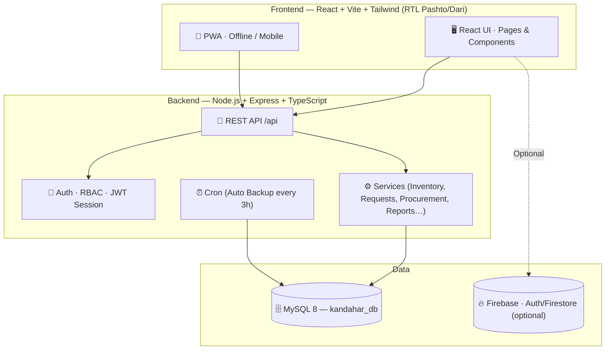
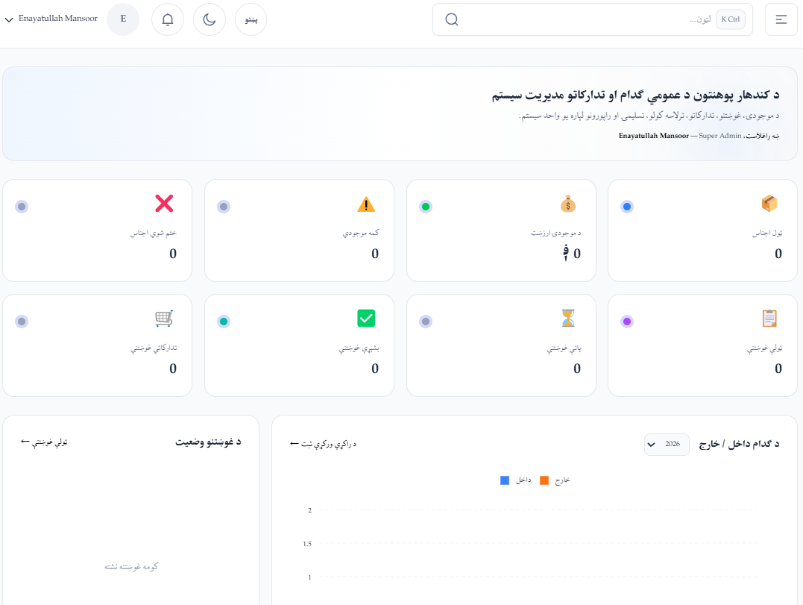
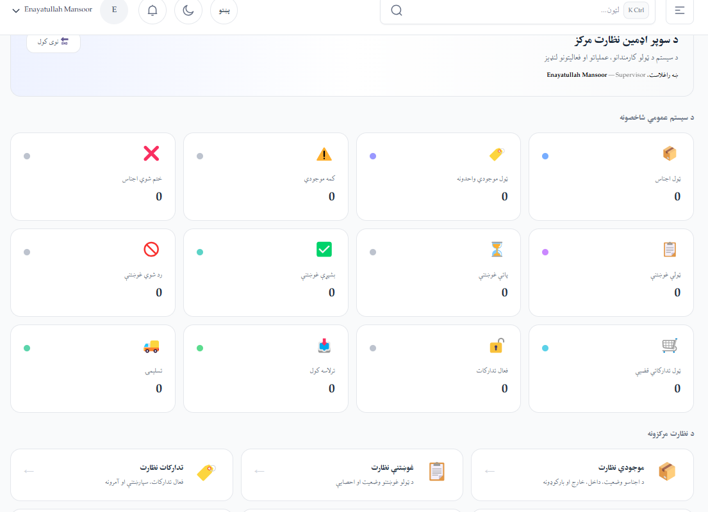

<div align="center">


# 🎓 Kandahar University — Warehouse Management & Procurement System (WMS)

**Full-Stack Final Year Project · Faculty of Computer Science · 2026**


</div>

---

<div align="center">


</div>

## 📖 Overview

A complete **Web-based Warehouse Management & Procurement System** built for **Kandahar University**. The platform manages inventory, stock movement, item requests with a full approval pipeline, procurement (vendor offers & purchase orders), receiving, delivery, official Afghan government forms, 13+ reports, notifications, budget codes, audit logs, soft-delete/recovery, and automatic SQL backups — all behind a secure **RBAC** (role-based access control) system.

The application interface is fully **RTL** with **Pashto/Dari** support and uses the **Afghan Shamsi (Solar Hijri) calendar**, matching the real administrative workflows of the university.

---

## ✨ Key Features

| Area | Modules |
|---|---|
| 📊 **Dashboard** | Live statistics, ApexCharts graphs, low-stock alerts, request & procurement status |
| 📦 **Inventory** | Item list, add/edit, Stock-In, Stock-Out, Stock Returns, Item Ledger, **barcode scanner**, checklist management (import from checklist files) |
| 🙋 **Requests** | Item request creation, pre-review, **delegation (کفیل) system**, request levels (Urgent / Normal / Low), tracking codes, full **approval pipeline** (Confirmer → Procurement → Warehouse → Delivery) |
| 🛒 **Procurement** | Procurement cases, vendor offers, winner selection, **Purchase Orders**, linked to official forms |
| 📥 **Receiving** | Receiving against POs & requests, receipt reports, FS5 form |
| 🚚 **Delivery** | Delivery to faculties & individuals, delivery form, items & quantities |
| 🔎 **Traceability** | Full lifecycle tracking of every item — request → procurement → receiving → delivery, per-person/per-department ledger |
| 📝 **Official Forms** | **7 official government/university forms** (proposal form, comparison form, purchase order, receipt report, FS5, tender…) rendered in isolated iframes |
| 📈 **Reports** | **13+ reports**: inventory, stock movement, requests, procurement, receiving/delivery, faculty, department, person assignment, annual needs, forecasting, audit activity, returns |
| 🔔 **Notifications** | Low-stock alerts, new request states, approval notifications |
| 💰 **Budget** | Budget codes, ceilings and limits |
| ⚙️ **Settings** | Email/SMS configuration, system settings, daily request limits, system health |
| 🗄️ **Backup** | **Automatic SQL backup every 3 hours**, download/restore, Excel-compatible export |
| 🗑️ **Trash & Recovery** | **Soft-delete** — nothing is ever permanently removed; recover from Trash |
| 👥 **Users & Roles** | **RBAC** with 7 roles, custom roles, user activation |
| 🕵️ **Super Admin** | Live system monitoring: analytics, inventory, requests, procurement, receiving |
| 🛡️ **Security** | JWT sessions, Helmet, rate limiting, CORS, **immutable audit logs**, bcrypt password hashing |

---

## 🧩 System Modules

| Module | Route |
|---|---|
| Dashboard | `/dashboard` |
| Inventory | `/inventory/items`, `/stock-in`, `/stock-out`, `/returns`, `/ledger`, `/barcode-scanner`, `/checklist` |
| Requests | `/requests`, `/requests/create`, `/requests/details/:id` |
| Procurement | `/procurement`, `/procurement/details/:id`, `/procurement/offers/:id` |
| Receiving | `/receiving`, `/receiving/details/:id` |
| Reports | `/reports` (+ 12 sub-reports) |
| Official Forms | `/official-forms` |
| Notifications | `/notifications` |
| Traceability | `/traceability` |
| Settings | `/settings`, `/user-management`, `/role-management`, `/delegation` |
| Super Admin | `/superadmin` (+ 5 monitors) |
| Maintenance | `/trash`, `/recovery-history`, `/backup`, `/health`, `/final-qa` |
| About | `/about` |

---

## 🛠️ Tech Stack

| Layer | Technology |
|---|---|
| 🎨 **Frontend** | React 18 · TypeScript · Vite 6 · Tailwind CSS 4 · React Router 7 · ApexCharts · FullCalendar · Firebase · QR/Barcode (jsqr, qrcode.react) · jalaali-js (Shamsi dates) · PWA |
| ⚙️ **Backend** | Node.js · Express 4 · TypeScript · mysql2 · JWT sessions · Helmet · CORS · Compression · Rate limiting · bcryptjs · Nodemailer · node-cron |
| 🗄️ **Database** | MySQL 8 (utf8mb4 / utf8mb4_unicode_ci) — 23+ tables |
| 🚀 **Deployment** | PM2 · ecosystem.config.cjs · Windows LAN scripts (`scripts/`) |

### 🏗️ System Architecture



---

## 📁 Project Structure

```
KWMS/
├── Backend/                  # Node.js + Express + TypeScript API
│   ├── src/
│   │   ├── config/           # DB connection
│   │   ├── controllers/      # Route handlers (21 files)
│   │   ├── database/         # schema.sql · seed.sql
│   │   ├── middleware/       # auth, RBAC, API security
│   │   ├── routes/           # 22 API route modules
│   │   ├── security/         # session/JWT tokens
│   │   ├── services/         # business logic (25 files)
│   │   ├── utils/
│   │   └── server.ts         # entry point
│   ├── tests/                # security + live API tests
│   ├── scripts/              # seed-admin, reset
│   ├── .env.example
│   └── package.json
│
├── Frontend/                 # React 18 + Vite + Tailwind SPA
│   ├── src/
│   │   ├── api/              # backend API client
│   │   ├── components/       # shared UI components
│   │   ├── constants/        # roles, permissions
│   │   ├── context/          # auth, theme…
│   │   ├── layouts/          # app + reports + settings layouts
│   │   ├── pages/            # 20+ page modules
│   │   ├── services/
│   │   ├── firebase/         # localStore / optional Firebase
│   │   └── App.tsx           # router (protected routes)
│   ├── public/
│   │   ├── forms/            # 7 official forms (iframe)
│   │   ├── fonts/            # Bahij Zar — Pashto font
│   │   └── team/             # team photos
│   ├── docs/                 # security notes + screenshots
│   ├── .env.example
│   └── package.json
│
├── DB/                       # database creation + restore docs
├── Backup/                   # automatic SQL backups
├── scripts/                  # LAN / Windows deployment scripts
└── .gitignore
```

---

## 🔐 Roles & Permissions (RBAC)

| Role | Allowed Modules |
|---|---|
| 👑 **Super Admin** | Everything — all modules, settings, backup, trash, monitoring |
| 🧑‍💼 **Admin** | Inventory, all requests, reports, read procurement, receiving |
| 🛒 **Procurement Director** | Procurement — management & approval |
| 🏭 **Warehouse Director** | Inventory (manage), receiving, stock-out, checklists |
| 📦 **Warehouse Entry Person** | Inventory, stock-in, receiving |
| 🙋 **Requester** | Create requests |
| ✅ **Request Confirmer** | Approve requests |

---

## 🚀 Getting Started

### Prerequisites

- **Node.js** ≥ 18
- **MySQL** Server 8.0+
- **npm**

### 1 — Database Setup

```bash
mysql -u root -p --default-character-set=utf8mb4
```

```sql
CREATE DATABASE IF NOT EXISTS kandahar_db CHARACTER SET utf8mb4 COLLATE utf8mb4_unicode_ci;
source Backend/src/database/schema.sql;
source Backend/src/database/seed.sql;
```

### 2 — Run the Backend

```bash
cd Backend
copy .env.example .env      # Windows   |   cp .env.example .env  (Linux/Mac)
# Edit .env and set your MySQL password
npm install
npm run dev
```

✔ Backend runs at `http://localhost:3001` — health check: `http://localhost:3001/api/health`

### 3 — Run the Frontend

```bash
cd Frontend
copy .env.example .env      # Windows   |   cp .env.example .env  (Linux/Mac)
npm install
npm run dev
```

✔ App opens at `http://localhost:5000`

> **Firebase (optional):** to enable live Firebase, add your Firebase Web App credentials to `Frontend/.env`. Without Firebase, the system runs in **Demo Mode**.

### 🔑 Default Login (Demo Mode)

| Email | Password |
|---|---|
| `admin@kandahar.edu.af` | `admin123` |

---

## 🔌 API Modules

| Module | Base Path |
|---|---|
| Authentication | `/api/auth` |
| Users | `/api/users` |
| Inventory | `/api/inventory` |
| Requests | `/api/requests` |
| Procurement | `/api/procurement` |
| Receiving | `/api/receiving` |
| Delivery | `/api/delivery` |
| Reports | `/api/reports` |
| Lookup (faculties, vendors…) | `/api/lookup` |
| Email & Email-Config | `/api/email` · `/api/email-config` |
| SMS | `/api/sms` |
| Traceability | `/api/traceability` |
| Management | `/api/management` |
| Custom Roles | `/api/custom-roles` |
| Budget | `/api/budget` |
| Trash | `/api/trash` |
| Checklist | `/api/checklist` |
| Backup | `/api/backup` |
| Delegations | `/api/delegations` |
| Settings | `/api/settings` |
| Health & Time | `/api/health` · `/api/time/now` |

---

## 📊 Reports

| Report | Description |
|---|---|
| Reports Dashboard | Overview of all reports |
| Inventory Report | Current stock levels |
| Stock Movement Report | Stock in/out/adjustment history |
| Request Report | Item requests overview |
| Procurement Report | Procurements, offers & POs |
| Receiving & Delivery Report | Received and delivered items |
| Faculty Report | Items by faculty |
| Department Report | Items by department |
| Person Assignment Report | Items assigned to individuals |
| Annual Needs Report | Yearly needs planning |
| Forecasting Report | Demand forecasting |
| Audit Activity Report | Immutable action history |
| Stock Return Report | Returned items |

---

## 🔒 Security & Backup

- 🔐 **JWT sessions** + **RBAC** — each role can only access its own modules
- 🛡️ **Helmet**, **rate limiting** (20 login attempts / 10 minutes), **CORS**, request controls
- 🧾 **Audit logs** — every action is recorded with old & new values; immutable
- 🗑️ **Soft-delete** — nothing is permanently removed; everything is recoverable from Trash
- 🗄️ **Automatic SQL backups** every 3 hours (node-cron) + Excel-compatible export
- 👤 **User activation** — new users can only log in after Super Admin approval
- ⚠️ Sensitive data (`.env`, session keys, credentials) is **never** committed to the repository

> 📌 Before the first production deployment, review and apply hardened production rules from `Frontend/firestore.rules`.

---

## 📸 Screenshots

| Dashboard | Dashboard |
|---|---|
|  |  |

---

## 🧪 Testing

The backend includes security and live API tests:

```bash
cd Backend
npm test                       # build + session-security tests
npm run test:live              # live API tests
```

---

## 👨‍👩‍👦 Project Team

| Member | Role |
|---|---|
| 🏆 **Enayatullah Mansoor** | Project Lead & Full Stack Developer |
| 💻 **Fazalrahman Mayar** | Frontend Developer |
| ⚙️ **Abdulhadi Rahimi** | Backend Developer |
| 📊 **Shamsurahman Mushfiq** | System Analyst |

## 🎓 Academic Supervision

> **Hikmatullah Omid**
> Faculty of Computer Science · Department of Networks
> *Academic Supervisor of the Final Year Project*

---

## 📜 License

This project was created for educational and academic purposes — **Kandahar University, Faculty of Computer Science, Final Year Project 2026**.

The frontend is based on the TailAdmin template; see `Frontend/LICENSE.md` for its license.

---

<div align="center">

**Kandahar University** 🎓 · Faculty of Computer Science · Final Year Project 2026

</div>